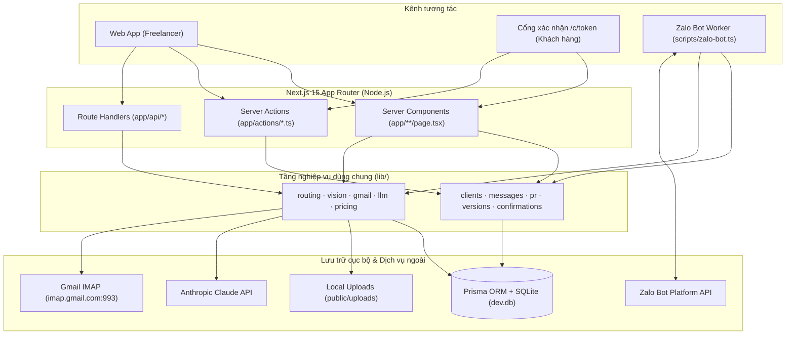

# Freevo

**Hệ thống quản lý phiên bản yêu cầu khách hàng theo mô hình Git dành cho freelancer.**


---

## Bài toán & Giải pháp

Trong quá trình làm việc tự do, yêu cầu dự án thường đến rải rác qua nhiều kênh như Zalo, Gmail hoặc ảnh chụp màn hình đoạn chat. Khách hàng thay đổi ý định liên tục qua từng buổi trao đổi khiến cả freelancer lẫn khách đều khó truy vết được **phiên bản phạm vi công việc đã chốt**, **bằng chứng cho từng thay đổi**, và **mức độ đội khối lượng so với ngân sách ban đầu**.

**Freevo** giải quyết bài toán này bằng cách áp dụng tư duy quản lý mã nguồn (Git) cho yêu cầu dự án:

1. **Gom hội thoại đa kênh** (Gmail IMAP 2 chiều, Zalo Bot, ảnh chụp màn hình qua AI Vision, hoặc nhập thủ công) về một hộp tin thống nhất theo từng khách hàng.
2. **Tổng hợp phiên trao đổi thành Pull Request (PR)**: AI phân tích các tin nhắn chưa xử lý, lọc bỏ phần đổi ý giữa chừng để chỉ giữ **quyết định chốt cuối cùng**, tách thành các thay đổi `add` / `modify` / `remove`, kèm **bằng chứng tin nhắn thật** cho từng mục.
3. **Duyệt PR, Merge thành Version bất biến & Rollback không phá hủy**: freelancer bật/tắt từng thay đổi, chọn lọc bằng chứng, rồi merge thành `v1`, `v2`, `v3`... Khi cần quay lui, rollback tạo phiên bản mới từ snapshot cũ mà không xóa lịch sử.
4. **Cổng xác nhận công khai & Ước lượng báo giá**: tạo liên kết `/c/[token]` gửi khách xác nhận nhanh không cần tài khoản, đồng thời ước lượng giá đề xuất theo điểm khối lượng và thuế suất cấu hình được.

---

## Tính năng chính

- **Thu thập hội thoại đa kênh:**
  - **Gmail IMAP 2 chiều (`/api/gmail/sync`)**: đồng bộ cả `INBOX` lẫn thư mục `Sent Mail` bằng `imapflow` + `mailparser`, tự lọc email hệ thống/marketing, cắt bỏ phần trích dẫn trả lời (`On ... wrote:`), hỗ trợ plus-alias (`user+tag@gmail.com`) và thẻ tiêu đề `GMAIL_SYNC_TAG`.
  - **Zalo Bot long-polling (`scripts/zalo-bot.ts`)**: nhận tin nhắn chuyển tiếp, chọn nhanh khách bằng `/khach`, gắn nhanh theo cú pháp `@<TênKhách> <nội dung>`, tổng hợp PR bằng `/xong`, hoặc gửi trực tiếp ảnh chụp màn hình.
  - **Bóc tách ảnh chụp đoạn chat bằng AI Vision (`/api/screenshots`)**: nhận diện kênh chat, tên/thông tin liên hệ trên header, ngân sách được nhắc tới và gộp hội thoại thành bản ghi kèm ảnh gốc lưu tại `public/uploads` (phục vụ qua `/api/uploads/[name]`).
  - **Nhập thủ công**: bổ sung ghi chú trao đổi trực tiếp trên trang chi tiết khách hàng.
- **Định tuyến 3 lớp & Hộp tin chưa phân loại (`/inbox`):**
  - Tự động khớp khách theo liên hệ (email, số điện thoại, Zalo nickname, tên khách) → chấm điểm từ khóa dựa trên tên dự án & snapshot yêu cầu hiện tại → gợi ý bằng Claude khi có nhiều khách hàng.
  - Tự động học email phụ vào hồ sơ khách khi gán tin từ hộp tin chưa phân loại, đồng thời tự động quét tin chờ và khởi tạo PR cho bản `v1` ngay khi tạo khách hàng mới.
- **Tổng hợp hội thoại thành PR có bằng chứng (`createPR`):**
  - Sử dụng Anthropic SDK với **Adaptive Thinking** + **Structured Outputs** (`json_schema`), tự suy luận vai trò người gửi (`client` / `freelancer`), trích xuất ngân sách (`detected_budget`) và ước lượng điểm khối lượng (`effort_delta`, 1 điểm tương đương nửa ngày công).
  - Lớp kiểm định phía server tự động loại bỏ thay đổi thiếu bằng chứng hợp lệ, sai `req_id`, hoặc trùng tiêu đề `add`, và tự điền trạng thái `before` từ snapshot hiện tại.
- **Duyệt PR, Merge, Versioning & Rollback:**
  - Giao diện `/pr/[id]` hiển thị diff trực quan (`add` / `modify` / `remove`), cho phép chỉnh sửa tiêu đề/chi tiết, bật/tắt chấp nhận từng thay đổi và chọn lọc bằng chứng chat + ảnh gốc trước khi merge.
  - Mỗi lần merge tạo một `Version` mới với ID yêu cầu cố định (`REQ-001`, `REQ-002`, ...); thao tác rollback tạo version mới sao chép nguyên vẹn snapshot đích để bảo toàn lịch sử.
- **Cổng xác nhận công khai (`/c/[token]`):**
  - Đường dẫn riêng tư theo token để khách hàng xem danh sách thay đổi đã duyệt (chỉ hiển thị bằng chứng được chọn), toàn bộ yêu cầu sau cập nhật, và phản hồi đồng ý hoặc từ chối kèm ghi chú.
- **Ước lượng báo giá & thuế (`lib/pricing.ts`):**
  - Tính đơn giá trung bình từ `PastProject` (hoặc `DEFAULT_UNIT_PRICE`), đối chiếu ngân sách khách để cảnh báo vượt ngân sách, tính số tiền thực nhận sau thuế (`TAX_RATE`) và quy đổi ngược mức giá cần báo cho thu nhập ròng mong muốn.

---

## Tổng quan kiến trúc

Freevo được thiết kế theo mô hình **Modular Monolith** chạy trên runtime Node.js của Next.js 15 kết hợp cùng **Zalo Bot Worker** chạy độc lập. Toàn bộ logic nghiệp vụ, kiểm định dữ liệu và truy cập Prisma tập trung trong tầng `lib/` để dùng chung cho Web UI (Server Components, Server Actions, Route Handlers) và Worker CLI.



> Xem phân tích chi tiết về phân tầng module, lược đồ cơ sở dữ liệu (ERD), luồng tổng hợp PR, quy trình định tuyến 3 lớp và mô hình định giá tại [`docs/ARCHITECTURE.md`](./docs/ARCHITECTURE.md).

---

## Công nghệ sử dụng

| Thành phần | Công nghệ / Thư viện | Vai trò trong hệ thống |
|---|---|---|
| Framework | Next.js 15 (App Router, Turbopack), React 19, TypeScript 5 | Giao diện SSR/Client Islands, Server Actions, Route Handlers |
| Styling & UI | Tailwind CSS 4, Radix UI, Lucide React | Hệ thống thiết kế tối giản theo dạng sổ cái, biểu tượng |
| ORM & Database | Prisma 6, SQLite (hỗ trợ chuyển sang PostgreSQL) | Lưu trữ khách hàng, hội thoại, PR, version, xác nhận và trạng thái bot |
| AI & Vision | `@anthropic-ai/sdk` (`claude-haiku-5-5`) | Structured outputs (`json_schema`), Adaptive Thinking, đọc ảnh chụp màn hình |
| Email Sync | `imapflow`, `mailparser` | Đồng bộ Gmail IMAP 2 chiều và phân tích MIME email |
| Runtime Scripts | `tsx` | Chạy background worker Zalo Bot, quản lý DB và kiểm thử luồng |

---

## Cấu trúc dự án

```text
.
├── app/
│   ├── page.tsx                    # Bảng điều khiển danh sách khách hàng
│   ├── layout.tsx                  # Root layout & cấu hình font Be Vietnam Pro
│   ├── inbox/page.tsx              # Hộp tin chưa phân loại & gợi ý gán khách
│   ├── clients/
│   │   ├── new/page.tsx            # Tạo khách hàng mới (tự quét tin & dựng PR v1)
│   │   └── [id]/page.tsx           # Chi tiết khách hàng (Hộp tin, Yêu cầu, Version, PR, Thông tin)
│   ├── pr/[id]/page.tsx            # Duyệt Pull Request, bằng chứng & bảng giá
│   ├── c/[token]/page.tsx          # Cổng xác nhận yêu cầu công khai cho khách hàng
│   ├── dev/components/page.tsx     # Trang xem trước UI components nội bộ
│   ├── actions/                    # Server Actions cho mutations (clients, pr)
│   └── api/                        # Route Handlers (/health, /gmail/sync, /screenshots, /uploads/[name])
├── components/                     # UI components theo domain (clients, pr, confirm, inbox, gmail, ui)
├── lib/                            # Tầng nghiệp vụ & tích hợp dùng chung cho Web và Worker
│   ├── db.ts                       # PrismaClient singleton & chuẩn hóa đường dẫn SQLite
│   ├── types.ts                    # Kiểu dữ liệu domain (ReqSnapshot, PRChange, Pricing, Vision)
│   ├── result.ts                   # Wrapper Result<T> chuẩn hóa lỗi cho Server Actions
│   ├── clients.ts                  # CRUD khách hàng, tự động quét tin & khởi tạo PR v1
│   ├── messages.ts                 # Lưu/truy vấn tin nhắn, gán khách & tự học email phụ
│   ├── pr.ts                       # createPR, updateChange, mergePR, rejectPR
│   ├── versions.ts                 # Truy vấn version & rollback không xóa lịch sử
│   ├── confirmations.ts            # Cổng xác nhận theo token công khai
│   ├── llm.ts                      # Giao tiếp Anthropic Claude (Structured Outputs + mock fallback)
│   ├── vision.ts                   # Lưu ảnh tải lên & bóc tách đoạn chat bằng AI Vision
│   ├── routing.ts                  # Điều phối ảnh chụp & định tuyến khách hàng 3 lớp
│   ├── gmail.ts                    # Đồng bộ Gmail IMAP 2 chiều & con trỏ BotState
│   ├── pricing.ts                  # Tính toán đơn giá, effort và đối chiếu ngân sách
│   └── pricing-calc.ts             # Hàm thuần tính thuế, thực nhận và định dạng VND
├── prisma/
│   ├── schema.prisma               # Lược đồ dữ liệu Prisma
│   └── seed.ts                     # Dữ liệu mẫu phục vụ phát triển & kiểm thử local
├── scripts/
│   ├── zalo-bot.ts                 # Background worker Zalo Bot (long-polling)
│   ├── zalo-probe.ts               # Kiểm tra kết nối API Zalo Bot (getMe)
│   ├── db-reset.ts                 # Khởi tạo lại schema SQLite và nạp seed
│   ├── db-clear.ts                 # Xóa sạch dữ liệu workspace và ảnh upload
│   ├── test-create-pr.ts           # Kiểm thử luồng tạo PR, merge, confirm, rollback
│   ├── test-flow.ts                # Kiểm thử end-to-end tầng lib/ ở chế độ LLM_MOCK=1
│   └── test-zalo-handle.ts         # Kiểm thử bộ xử lý lệnh Zalo ở chế độ ZALO_DRY=1
└── docs/
    └── ARCHITECTURE.md             # Tài liệu kiến trúc kỹ thuật chi tiết
```

---

## Hướng dẫn cài đặt & chạy local

### Yêu cầu môi trường

- **Node.js** 20 trở lên
- **npm** đi kèm Node.js

### Các bước thiết lập

```bash
# 1. Cài đặt thư viện
npm install

# 2. Tạo file cấu hình môi trường
cp .env.example .env
# Mở .env và điền ANTHROPIC_API_KEY (hoặc bật LLM_MOCK=1 để chạy offline)

# 3. Tạo database SQLite local và nạp dữ liệu mẫu (tùy chọn)
npm run db:reset
# Nếu muốn bắt đầu với workspace hoàn toàn trống:
# npm run db:clear

# 4. Khởi chạy ứng dụng web tại http://localhost:3000
npm run dev
```

*(Tùy chọn)* Chạy **Zalo Bot Worker** ở một terminal riêng sau khi đã điền `ZALO_BOT_TOKEN` trong `.env`:

```bash
npm run zalo-bot
```

> **Chế độ không cần API key:** Đặt `LLM_MOCK=1` trong `.env` để sử dụng bộ sinh đề xuất và bóc tách ảnh mô phỏng cục bộ khi phát triển hoặc chạy test offline.

---

## Biến môi trường

| Biến | Mặc định | Mô tả |
|---|---|---|
| `DATABASE_URL` | `file:./dev.db` | Chuỗi kết nối Prisma (mặc định trỏ vào `prisma/dev.db`) |
| `ANTHROPIC_API_KEY` | *(trống)* | API key Anthropic; bắt buộc khi `LLM_MOCK` không bật |
| `LLM_MODEL` | `claude-haiku-5-5` | Model Claude dùng cho tổng hợp PR, Vision và gợi ý định tuyến |
| `LLM_MOCK` | *(không đặt)* | Đặt `1` để chạy mô phỏng deterministic không gọi Anthropic API |
| `APP_URL` | `http://localhost:3000` | URL gốc dùng để tạo liên kết PR và liên kết xác nhận `/c/[token]` |
| `TAX_RATE` | `0.1` | Thuế suất khấu trừ mặc định dùng trong bảng ước lượng giá |
| `DEFAULT_UNIT_PRICE` | `772917` | Đơn giá/điểm mặc định (VND) khi chưa có dữ liệu `PastProject` |
| `ZALO_BOT_TOKEN` | *(trống)* | Token từ Zalo Bot Platform cho worker `scripts/zalo-bot.ts` |
| `ACTIVE_CLIENT_TTL_HOURS` | `2` | Thời gian (giờ) bot ghi nhớ khách hàng đang chọn trước khi hết hạn |
| `GMAIL_USER` | *(trống)* | Địa chỉ Gmail dùng để đồng bộ IMAP 2 chiều |
| `GMAIL_APP_PASSWORD` | *(trống)* | Mật khẩu ứng dụng Google (App Password 16 ký tự) |
| `GMAIL_SYNC_TAG` | `[Freevo]` | Thẻ tiêu đề cho phép tự import email tự gửi cho chính mình |
| `NEXT_DIST_DIR` | `.next` | Thư mục build tùy chỉnh cho Next.js (tùy chọn) |

---

## Lệnh phát triển & kiểm thử

| Lệnh | Mô tả |
|---|---|
| `npm run dev` | Khởi chạy server phát triển Next.js với Turbopack (`-H 0.0.0.0`) |
| `npm run build` | Build ứng dụng production bằng Turbopack |
| `npm run start` | Chạy bản build production |
| `npm run lint` | Kiểm tra mã nguồn bằng ESLint |
| `npm run db:reset` | Reset `prisma/dev.db`, đẩy schema và nạp dữ liệu mẫu từ `prisma/seed.ts` |
| `npm run db:clear` | Xóa toàn bộ bản ghi dữ liệu, reset con trỏ sync và dọn `public/uploads` |
| `npm run test:flow` | Chạy kiểm thử tích hợp end-to-end toàn bộ luồng nghiệp vụ trong `lib/` (`LLM_MOCK=1`) |
| `npm run test:pr` | Chạy kiểm thử luồng `createPR` → `mergePR` → `confirm` → `rollback` (theo cấu hình `.env`) |
| `npm run zalo-bot` | Khởi chạy worker long-polling nhận tin nhắn và ảnh từ Zalo Bot Platform |
| `npm run zalo-probe` | Gọi API `getMe` để kiểm tra tính hợp lệ của `ZALO_BOT_TOKEN` |
