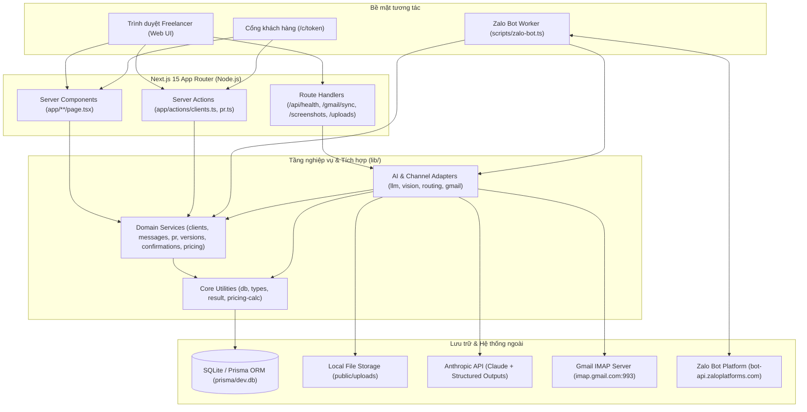
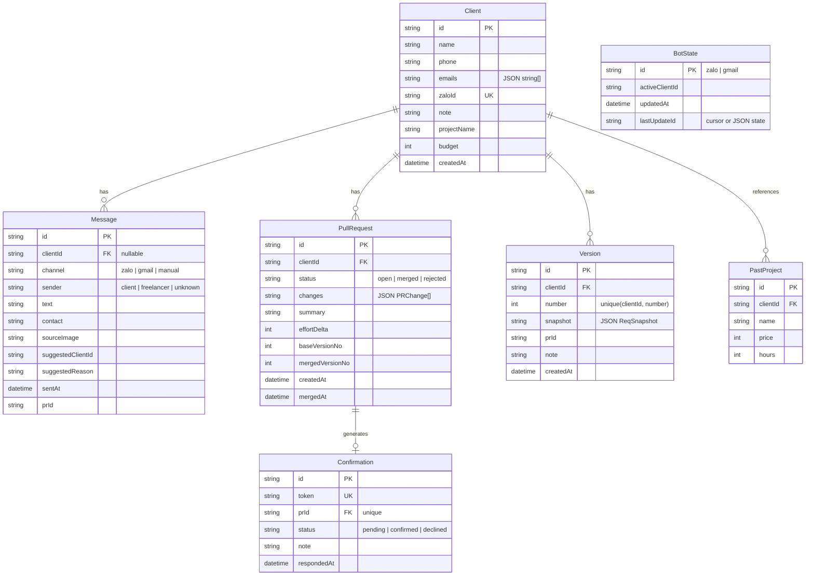
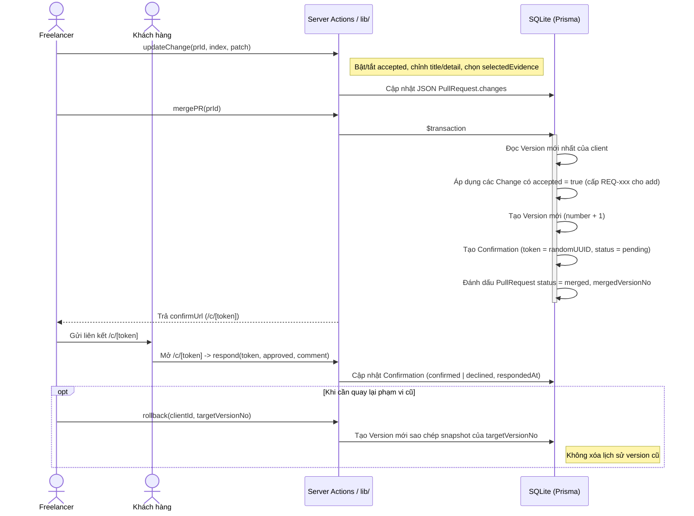
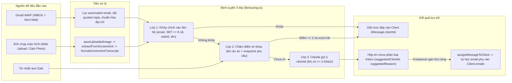

# Kiến trúc hệ thống Freevo

Tài liệu này mô tả kiến trúc kỹ thuật thực tế của **Freevo** — bao gồm phân tầng mã nguồn, mô hình dữ liệu, các luồng xử lý cốt lõi (tổng hợp PR bằng AI, hợp nhất & rollback phiên bản, thu thập đa kênh & định tuyến 3 lớp), mô hình tính giá và hướng dẫn mở rộng.

---

## 1. Tổng quan kiến trúc (System Overview)

Freevo được xây dựng theo kiến trúc **Modular Monolith** đặt bên trong runtime Node.js của **Next.js 15 (App Router)**, đi kèm một **Background Worker** độc lập cho Zalo Bot (`scripts/zalo-bot.ts`).

Nguyên tắc thiết kế cốt lõi:
- **Single Source of Business Logic (`lib/`)**: Toàn bộ quy tắc nghiệp vụ, kiểm định dữ liệu đầu vào, tương tác LLM/Vision/IMAP và truy vấn Prisma đều nằm trong `lib/`. Cả Web UI (Server Components, Server Actions, Route Handlers) lẫn Zalo Worker đều gọi trực tiếp cùng một bộ hàm này.
- **Database-backed State Cursors**: Trạng thái đồng bộ của Gmail IMAP và phiên chọn khách của Zalo Bot được lưu bền vững trong bảng `BotState`, đảm bảo khởi động lại tiến trình không làm trùng lặp dữ liệu.
- **Human-in-the-loop AI**: AI chỉ đóng vai trò tổng hợp đề xuất (`PullRequest` ở trạng thái `open`) kèm trích dẫn tin nhắn thật (`Message.id`). Mọi thay đổi chỉ có hiệu lực sau khi freelancer duyệt và merge thành `Version`.



---

## 2. Phân tầng ứng dụng (Layered Architecture)

### 2.1. App Router Pages (`app/`) & Client Islands (`components/`)

Các trang chính đều khai báo `export const dynamic = "force-dynamic"` để đọc trực tiếp trạng thái mới nhất từ SQLite trên server rồi truyền dữ liệu đã chuẩn hóa xuống các Client Components trong `components/`.

| Route | File | Vai trò | Thành phần Client chính |
|---|---|---|---|
| `/` | `app/page.tsx` | Danh sách khách hàng, số tin chờ, PR mở, ngân sách & nút đồng bộ Gmail | `SyncGmailButton`, `ConfirmationBadge` |
| `/inbox` | `app/inbox/page.tsx` | Hộp tin chưa phân loại (`clientId = null`), gợi ý gán khách & tải ảnh chụp | `InboxUnassignedClient` |
| `/clients/new` | `app/clients/new/page.tsx` | Tạo khách hàng mới; tự động quét tin chưa phân loại và dựng PR v1 nếu khớp | `NewClientForm`, `ClientFormFields` |
| `/clients/[id]` | `app/clients/[id]/page.tsx` | Hồ sơ khách hàng 5 tab: Hộp tin, Yêu cầu hiện tại, Lịch sử version, PR, Thông tin | `ClientTabs`, `InboxTab`, `RequirementsTab`, `VersionsTab`, `PrsTab`, `InfoTab` |
| `/pr/[id]` | `app/pr/[id]/page.tsx` | Duyệt Pull Request: diff thay đổi, bằng chứng chat/ảnh, bảng giá & merge/reject | `PRReviewClient`, `EvidenceBubble`, `PricingPanel` |
| `/c/[token]` | `app/c/[token]/page.tsx` | Trang xác nhận công khai cho khách hàng không cần đăng nhập | `ConfirmClient` |
| `/dev/components` | `app/dev/components/page.tsx` | Trang xem trước các UI component dùng chung khi phát triển | `DiffRow`, `VersionSpine`, `MoneyBlock`, `EvidenceQuote` |

### 2.2. Server Actions (`app/actions/`)

Mọi thao tác ghi từ giao diện đi qua Server Actions (`"use server"`), bọc qua helper `wrap()` trong `lib/result.ts` để trả về kiểu `Result<T>` (`{ ok: true, data }` hoặc `{ ok: false, error }`), kèm `revalidatePath()` cho các route bị ảnh hưởng.

| File | Server Actions | Nghiệp vụ gọi tới |
|---|---|---|
| `app/actions/clients.ts` | `createClientAction`, `updateClientAction`, `addManualMessageAction`, `assignMessageAction`, `assignContactMessagesAction`, `dismissUnassignedMessageAction` | `lib/clients.ts`, `lib/messages.ts` |
| `app/actions/pr.ts` | `createPRAction`, `updateChangeAction`, `mergePRAction`, `rejectPRAction`, `rollbackAction`, `respondConfirmationAction` | `lib/pr.ts`, `lib/versions.ts`, `lib/confirmations.ts` |

### 2.3. Route Handlers (`app/api/`)

Route Handlers được dùng cho các tác vụ HTTP thuần (healthcheck, đồng bộ ngoại vi, upload tệp nhị phân và phục vụ ảnh tĩnh động):

- `GET /api/health` (`app/api/health/route.ts`): trả `{ ok: true }` kiểm tra trạng thái server.
- `POST /api/gmail/sync` (`app/api/gmail/sync/route.ts`): kích hoạt `syncGmailInbox()`, revalidate `/`, `/inbox` và các trang `/clients/[id]` có tin mới.
- `POST /api/screenshots` (`app/api/screenshots/route.ts`): nhận `multipart/form-data` (`file`, tùy chọn `clientId`), gọi `ingestScreenshot()` để lưu ảnh, trích xuất hội thoại và định tuyến khách hàng.
- `GET /api/uploads/[name]` (`app/api/uploads/[name]/route.ts`): kiểm tra tên tệp bằng regex `SAFE_NAME` và trả nội dung ảnh từ `public/uploads/` với header `Cache-Control: immutable`.

### 2.4. Tầng nghiệp vụ & Tích hợp (`lib/`)

| Module | Trách nhiệm |
|---|---|
| `lib/db.ts` | Khởi tạo `PrismaClient` singleton và chuẩn hóa đường dẫn `file:./dev.db` về `prisma/dev.db` |
| `lib/types.ts` | Định nghĩa domain types: `Req`, `ReqSnapshot`, `PRChange`, `LlmProposal`, `Pricing`, `ScreenshotExtraction`, `Result<T>` |
| `lib/result.ts` | Helper `wrap(fn)` chuẩn hóa ngoại lệ thành `Result<T>` |
| `lib/clients.ts` | `listClients`, `getClientDetail`, `createClient`, `updateClient`, `findOrCreateClientByName`, kiểm định dữ liệu đầu vào |
| `lib/messages.ts` | `addMessage`, `listMessages`, `listPendingMessages`, `listUnassignedMessages`, `assignMessageToClient` (kèm tự học email), `scanAndAttachMessagesForClient` |
| `lib/pr.ts` | `createPR` (gọi AI + kiểm định server + transaction), `getPR`, `updateChange`, `mergePR`, `rejectPR` |
| `lib/versions.ts` | `getLatestVersion`, `listVersions`, `rollback` (tạo version mới từ snapshot lịch sử) |
| `lib/confirmations.ts` | `getByToken` (tải dữ liệu xác nhận công khai), `respond` (ghi nhận `confirmed` hoặc `declined`) |
| `lib/llm.ts` | Tích hợp Anthropic SDK (`proposeDiff`), định nghĩa `PROPOSAL_SCHEMA`, `SYSTEM_PROMPT` và mock deterministic khi `LLM_MOCK=1` |
| `lib/vision.ts` | `saveUploadedImage` (giới hạn 10MB, chuẩn hóa MIME) & `extractFromScreenshot` qua Claude Vision |
| `lib/routing.ts` | `findMatchingClientByContact`, `suggestClientForText` (3 lớp), `formatScreenshotTranscript`, `ingestScreenshot` |
| `lib/gmail.ts` | Đồng bộ Gmail IMAP 2 chiều (`syncGmailInbox`), lọc email tự động, cắt chuỗi reply trích dẫn, quản lý con trỏ `uidValidity` & `seenUids` |
| `lib/pricing.ts` | `getSerializablePricing`, `getPricing` (đơn giá từ `PastProject`, effort hiện tại/đề xuất, đối chiếu ngân sách) |
| `lib/pricing-calc.ts` | Hàm tính thuần `calcNet`, `calcPriceForNet`, `formatVND` dùng chung cho server và client |

### 2.5. Background Worker (`scripts/zalo-bot.ts`)

Worker chạy tiến trình riêng qua `npm run zalo-bot`:
1. Gọi `deleteWebhook` một lần khi khởi động để bảo đảm chế độ long-polling hoạt động độc lập.
2. Duy trì vòng lặp `getUpdates` (`timeout: 30` giây) với cơ chế **exponential backoff** (1s → tối đa 30s) khi gặp lỗi mạng hoặc API, đồng thời chống xử lý trùng bằng `seen` Set và `BotState.lastUpdateId`.
3. Xử lý tin nhắn văn bản:
   - `/help`, `/start`: hướng dẫn lệnh.
   - `/khach` hoặc `/khach <tên>`: liệt kê hoặc chọn/tạo khách hàng đang hoạt động (`BotState.activeClientId` với thời hạn `ACTIVE_CLIENT_TTL_HOURS`), tự động gắn lại các tin vừa gửi trước đó trong phiên (`heldMsgIds`).
   - `@<TênKhách> <nội dung>`: khớp tiền tố tên khách (ưu tiên tên dài hơn, không phân biệt dấu tiếng Việt) để gắn trực tiếp tin nhắn.
   - `/xong`: gọi `createPR(activeClientId)` và trả liên kết `/pr/[id]`.
   - Văn bản tự do: gắn vào `activeClientId` nếu còn hiệu lực TTL, hoặc lưu vào hộp tin chưa phân loại kèm gợi ý từ `suggestClientForText`.
4. Xử lý tin nhắn ảnh: tải ảnh từ URL/file, tự nhận diện MIME từ header hoặc magic bytes (PNG/JPEG/GIF/WebP) và gọi `ingestScreenshot()` với `channelOverride: "zalo"`.

---

## 3. Mô hình dữ liệu (Data Model)

Lược đồ trong `prisma/schema.prisma` sử dụng 7 model chính:



### Các quyết định thiết kế dữ liệu quan trọng

1. **Phiên trao đổi ngầm định (Implicit Session):** Không tồn tại bảng `Session` riêng. Mọi `Message` có `clientId = X` và `prId = null` tạo thành phiên trao đổi đang chờ của khách `X`. Khi `createPR(X)` chạy thành công, các tin nhắn này được gắn `prId` trong cùng một transaction.
2. **Version bất biến & ID yêu cầu ổn định:** Mỗi `Version` lưu toàn bộ mảng `Req` (`id`, `title`, `detail`, `status`) dưới dạng JSON `ReqSnapshot`. Mã `REQ-001`, `REQ-002`... được cấp tăng dần khi merge thao tác `add` và giữ nguyên vĩnh viễn qua các lần `modify`, `remove` hoặc `rollback`.
3. **Con trỏ đồng bộ trong `BotState`:**
   - Bản ghi `id = "zalo"` lưu `activeClientId`, `updatedAt` (kiểm tra TTL) và `lastUpdateId`.
   - Bản ghi `id = "gmail"` lưu JSON cursor trong `lastUpdateId` gồm `syncedAfter`, `uidValidity`, `seenUids`, `sentUidValidity` và `seenSentUids` (giới hạn 300 UID gần nhất cho mỗi hòm thư).

---

## 4. Các luồng xử lý cốt lõi (Core Data Flows)

### 4.1. Tổng hợp hội thoại thành PR (`createPR`)

```mermaid
sequenceDiagram
    actor User as Freelancer / Zalo Bot
    participant PR as lib/pr.ts (createPR)
    participant DB as SQLite (Prisma)
    participant LLM as lib/llm.ts (Claude API)

    User->>PR: createPR(clientId)
    PR->>DB: Lấy Version mới nhất & Message (prId = null, sort sentAt asc)
    alt Không có tin nhắn mới
        PR-->>User: Ném lỗi "Không có tin nhắn mới"
    end
    PR->>PR: Ánh xạ Message.id sang mã ngắn (m1, m2, ...)
    PR->>LLM: proposeDiff(snapshot, versionNo, llmMsgs)
    Note right of LLM: Adaptive Thinking + Structured Outputs (PROPOSAL_SCHEMA)
    LLM-->>PR: LlmProposal (summary, effort_delta, detected_budget, message_roles, changes)

    PR->>PR: Kiểm định phía server
    Note right of PR: 1) Ánh xạ evidence_refs -> Message.id, bỏ change nếu rỗng; 2) Kiểm tra req_id với modify/remove; 3) Chống trùng tiêu đề add; 4) Điền before từ snapshot

    PR->>DB: $transaction
    activate DB
    DB->>DB: Cập nhật sender cho Message có role = unknown
    DB->>DB: Tạo PullRequest (status = open)
    DB->>DB: Cập nhật Client.budget nếu có detected_budget > 0
    DB->>DB: Gắn prId cho toàn bộ tin nhắn trong phiên
    deactivate DB
    PR-->>User: Trả về PullRequest + token usage
```

### 4.2. Merge PR, Cổng xác nhận khách hàng & Rollback



### 4.3. Thu thập đa kênh & Định tuyến khách hàng 3 lớp



---

## 5. Mô hình ước lượng giá & thuế (`lib/pricing.ts`, `lib/pricing-calc.ts`)

Hệ thống ước lượng giá dựa trên tổng điểm khối lượng (`effortDelta`, quy ước 1 điểm tương đương nửa ngày công) của các PR đã merge cộng với PR đang mở:

1. **Đơn giá tham chiếu (`unitPrice`)**:
   - Lấy trung bình `price / max(hours, 1)` từ danh sách `PastProject` của khách hàng; nếu khách chưa có dự án cũ thì dùng toàn bộ `PastProject` trong hệ thống; nếu vẫn trống thì fallback về `DEFAULT_UNIT_PRICE` (mặc định `772917`).
2. **Khối lượng công việc**:
   - `currentEffort` = tổng `effortDelta` của các `PullRequest` có `status = "merged"`.
   - `proposedEffort` = `currentEffort + pr.effortDelta` (nếu đang xem PR có `status = "open"`).
3. **Giá đề xuất & thuế**:
   - `suggestedPrice` = làm tròn đến `100.000 ₫` gần nhất của `proposedEffort × unitPrice`.
   - `netSuggested` = `Math.round(suggestedPrice × (1 − TAX_RATE))`.
   - `priceForNet(desiredNet)` = làm tròn lên bội số `100.000 ₫` của `desiredNet / (1 − TAX_RATE)`.
   - `overBudget` = `true` khi khách có `budget` và `suggestedPrice > budget`.

---

## 6. Bảo mật, Xử lý lỗi & Kiểm thử

- **Kiểm định tại tầng `lib/`**: Toàn bộ ràng buộc (tên khách không rỗng, định dạng email, ngân sách không âm, kích thước ảnh tối đa 10MB, chỉ cho phép PNG/JPEG/WebP/GIF) được thực thi ngay trong `lib/` để dùng chung cho Web và Worker.
- **Chống Path Traversal khi phục vụ ảnh tải lên**: Route `/api/uploads/[name]` kiểm tra tên tệp theo biểu thức `^[a-zA-Z0-9_-]+\.(png|jpg|jpeg|webp|gif)$` trước khi đọc từ `public/uploads/`.
- **Chuẩn hóa lỗi Server Actions**: `wrap()` trong `lib/result.ts` chặn ngoại lệ chưa xử lý và trả `{ ok: false, error }` cho UI hiển thị thông báo rõ ràng.
- **Kiểm thử offline deterministic**: Đặt `LLM_MOCK=1` cho phép chạy `npm run test:flow` kiểm tra toàn bộ vòng đời khách hàng, PR, pricing, merge, confirmation, rollback, tự động học email và bóc tách screenshot mà không cần gọi API ngoài.

---

## 7. Ghi chú mở rộng (PostgreSQL & Production)

Freevo mặc định dùng SQLite để chạy local không cần dịch vụ ngoài. Khi cần triển khai trên PostgreSQL:

1. Trong `prisma/schema.prisma`, đổi `provider = "sqlite"` thành `provider = "postgresql"`.
2. Chuyển trường `Client.emails` từ `String @default("[]")` sang `String[]` (hoặc giữ JSON string nếu muốn tương thích đồng nhất) và cập nhật `parseEmails` trong `lib/clients.ts` / `lib/routing.ts` tương ứng.
3. Cấu hình `DATABASE_URL` trỏ tới PostgreSQL và chạy `npx prisma db push`.
4. Nếu tách môi trường multi-user trong tương lai, bổ sung xác thực người dùng tại tầng middleware/Server Actions và gắn `ownerId` vào `Client`, `PastProject` và `BotState`.
